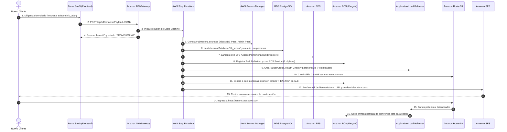
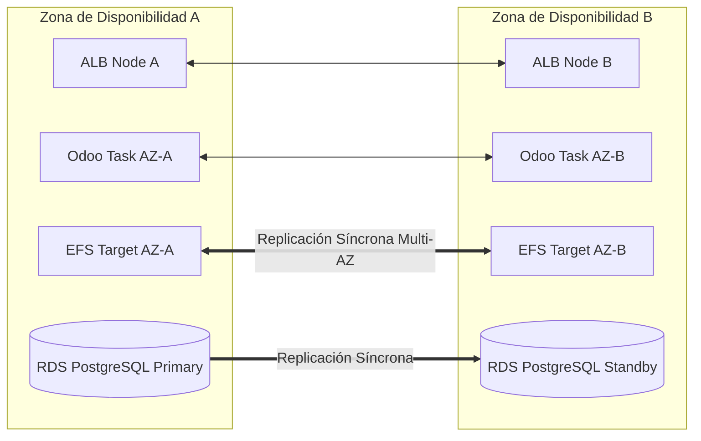
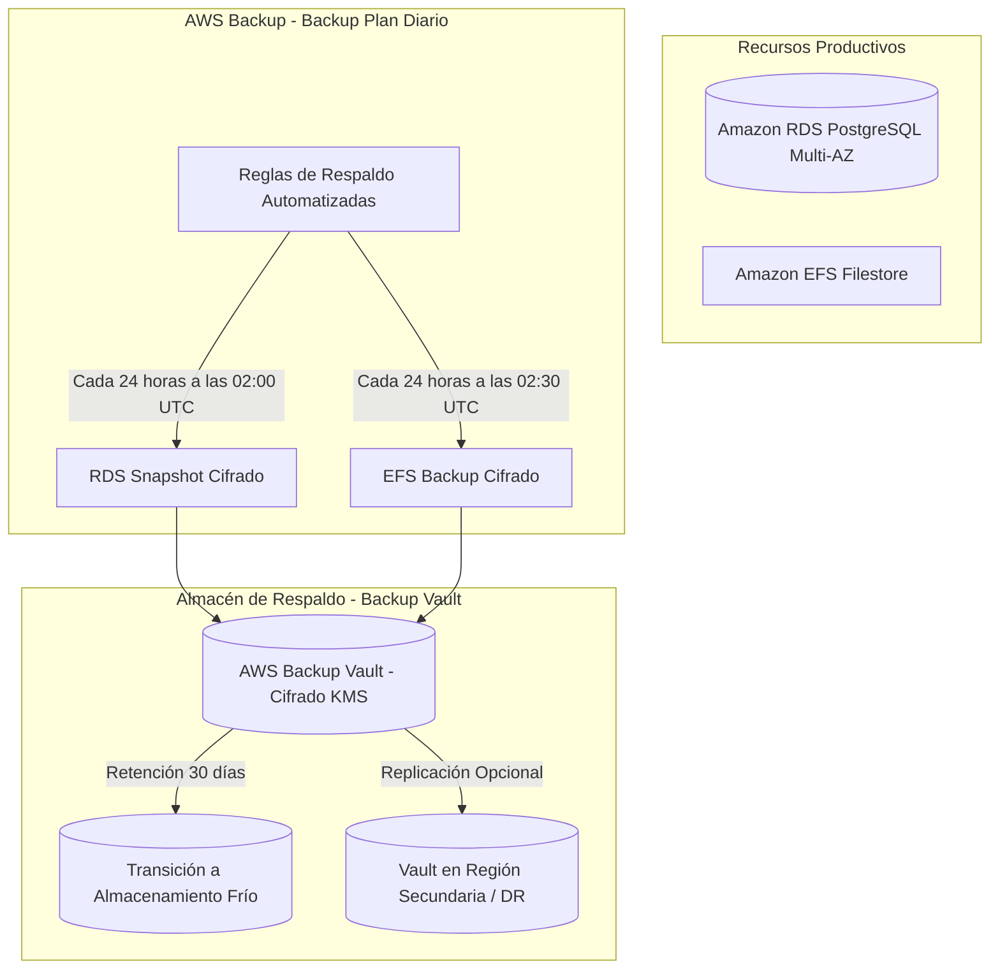

# Documento de Arquitectura y Justificación Técnica
## Plataforma SaaS de Odoo 18 sobre Amazon Web Services (AWS)

---

### Metadatos del Documento
- **Proyecto:** Diseño de Arquitectura para Plataforma SaaS Multicliente de Odoo 18
- **Equipo:** Equipo de Arquitectura Cloud & DevOps (2 integrantes)
- **Versión:** 1.0 (Producción / Enterprise Architecture Specification)
- **Estado:** Aprobado para Presentación y Sustentación Técnica
- **Restricción Principal de Diseño:** **Cero instancias Amazon EC2** en todos los componentes (100% Servicios Administrados y Serverless / Cómputo de Contenedores sin Servidor).

---

## Índice General

1. [Resumen Ejecutivo](#1-resumen-ejecutivo)
2. [Descripción General de la Plataforma SaaS](#2-descripción-general-de-la-plataforma-saas)
   - 2.1 Visión del Negocio y Propósito Técnico
   - 2.2 Principios Rectores de Arquitectura
   - 2.3 Comparativa y Selección del Modelo Multi-Tenant
3. [Arquitectura Propuesta y Desglose por Capas](#3-arquitectura-propuesta-y-desglose-por-capas)
   - 3.1 Capa de Edge, Tráfico Global y Seguridad Perimetral
   - 3.2 Capa de Balanceo y Enrutamiento de Tráfico
   - 3.3 Capa de Cómputo Administrado sin Servidores (Zero-EC2)
   - 3.4 Capa de Almacenamiento Persistente de Archivos (Filestore)
   - 3.5 Capa de Bases de Datos Relacionales
   - 3.6 Capa de Gestión de Secretos, Configuración y Cifrado
   - 3.7 Topología de Red y Conectividad VPC
   - 3.8 Capa de Control y Aprovisionamiento Automatizado (SaaS Control Plane)
4. [Modelo de Clientes y Aislamiento Multi-Tenant](#4-modelo-de-clientes-y-aislamiento-multi-tenant)
   - 4.1 Estrategia de Aislamiento en Cómputo, Datos y Red
   - 4.2 Matriz de Tiers de Servicio (Standard, Professional, Enterprise)
   - 4.3 Mitigación Técnica del Efecto "Noisy Neighbor"
5. [Aprovisionamiento Automatizado de Nuevos Clientes (Escenario 1)](#5-aprovisionamiento-automatizado-de-nuevos-clientes-escenario-1)
   - 5.1 Flujo Operativo End-to-End
   - 5.2 Máquina de Estados con AWS Step Functions
   - 5.3 Diagrama de Secuencia del Onboarding
   - 5.4 Manejo de Excepciones y Rollback Automatizado (Patrón Saga)
6. [Estrategia de Escalabilidad Dinámica (Escenario 2)](#6-estrategia-de-escalabilidad-dinámica-escenario-2)
   - 6.1 Escalabilidad Horizontal de Aplicación en Fargate
   - 6.2 Escalabilidad Vertical sin Interrupción de Servicio
   - 6.3 Escalabilidad de la Capa de Datos (RDS PostgreSQL)
7. [Alta Disponibilidad, Resiliencia y Recuperación ante Fallos (Escenario 3)](#7-alta-disponibilidad-resiliencia-y-recuperación-ante-fallos-escenario-3)
   - 7.1 Diseño Multi-AZ y Eliminación de SPOF
   - 7.2 Comportamiento ante Caída de Contenedores y Tareas
   - 7.3 Comportamiento ante Falla de Zona de Disponibilidad (AZ Outage)
   - 7.4 Recuperación Automática de Base de Datos (RDS Failover)
   - 7.5 RTO (Recovery Time Objective) y RPO (Recovery Point Objective)
8. [Seguridad Integral, Gobernanza y Protección de Información](#8-seguridad-integral-gobernanza-y-protección-de-información)
   - 8.1 Seguridad en Tránsito y Gestión de Certificados SSL/TLS
   - 8.2 Seguridad en Reposo con AWS KMS
   - 8.3 Protección de Capa Web (AWS WAF y Mitigación OWASP Top 10)
   - 8.4 Gestión Segura de Credenciales y Secretos
   - 8.5 Menor Privilegio con AWS IAM y Aislamiento por Tarea
9. [Almacenamiento Persistente y Estrategia de Respaldos](#9-almacenamiento-persistente-y-estrategia-de-respaldos)
   - 9.1 Gestión del Filestore de Odoo con Amazon EFS
   - 9.2 Políticas de Respaldo Centralizadas con AWS Backup
   - 9.3 Point-In-Time-Recovery (PITR) y Snapshots de RDS
   - 9.4 Procedimiento de Restauración ante Desastres
10. [Observabilidad, Monitoreo y Operaciones](#10-observabilidad-monitoreo-y-operaciones)
    - 10.1 Métricas y Telemetría con Amazon CloudWatch
    - 10.2 Centralización de Logs y Auditoría
    - 10.3 Alarmas Automatizadas y Runbooks de Respuesta
11. [Gestión del Ciclo de Vida, Actualizaciones y CI/CD](#11-gestión-del-ciclo-de-vida-actualizaciones-y-cicd)
    - 11.1 Integración de Módulos Personalizados (Addons del Repositorio)
    - 11.2 Pipeline de Entrega Continua (CI/CD)
    - 11.3 Estrategia de Despliegues Zero-Downtime y Migración de Esquemas
12. [Optimización de Costos y Facturación por Cliente](#12-optimización-de-costos-y-facturación-por-cliente)
    - 12.1 Identificación de Controladores de Costo
    - 12.2 Atribución de Costos por Tenant (Cost Allocation Tags)
    - 12.3 Estrategias de Reducción y Eficiencia de Gasto
13. [Justificación de la Selección Tecnológica (Por qué es la solución idónea)](#13-justificación-de-la-selección-tecnológica)
14. [Guía de Sustentación para Evaluación (Resolución de los 6 Casos del Reto)](#14-guía-de-sustentación-para-evaluación)

---

## 1. Resumen Ejecutivo

El presente documento expone el diseño integral de una plataforma **Software as a Service (SaaS)** para ofrecer el ERP **Odoo 18**, concebida para operar de manera elástica, resiliente, estandarizada y segura sobre la nube de **Amazon Web Services (AWS)**.

La solución resuelve el dilema fundamental entre **velocidad de aprovisionamiento**, **aislamiento entre clientes**, **facilidad de escalamiento independiente** y **control de costos operativos**, respetando en forma irrestricta la directriz obligatoria del reto: **prohibición total de instancias Amazon EC2**, tanto en la capa de cómputo directo como en el soporte subyacente de clústeres autogestionados.

Para satisfacer esta restricción con estándares de nivel empresarial, la arquitectura adopta un enfoque **100% Serverless y Contenedores Administrados**:
- **Capa de Ejecución de Odoo:** **AWS Fargate** orquestado mediante **Amazon Elastic Container Service (ECS)**, garantizando tareas efímeras, auto-recuperables y con asignación estricta de CPU y memoria por cliente.
- **Capa de Datos:** **Amazon RDS for PostgreSQL en despliegue Multi-AZ**, aprovechando réplicas síncronas entre zonas de disponibilidad, escalabilidad automática de almacenamiento y mecanismos de aislamiento lógico por base de datos y usuario dedicado por tenant.
- **Capa de Almacenamiento de Archivos (Filestore):** **Amazon Elastic File System (EFS)** en modo Multi-AZ con **EFS Access Points** específicos por cliente, resolviendo el almacenamiento concurrente y persistente de adjuntos de Odoo sin requerir servidores NFS dedicados.
- **Plataforma de Aprovisionamiento (SaaS Control Plane):** Completamente desacoplada del plano de datos mediante **Amazon API Gateway**, **AWS Step Functions**, **AWS Lambda**, **AWS Secrets Manager** y **Amazon DynamoDB**, permitiendo el aprovisionamiento de un nuevo entorno de cliente en **menos de 3 minutos sin intervención humana**.

---

## 2. Descripción General de la Plataforma SaaS

### 2.1 Visión del Negocio y Propósito Técnico
La plataforma SaaS de Odoo busca transformar la entrega de Odoo 18 de un modelo artesanal (donde cada cliente requiere desplegar una máquina virtual, instalar paquetes, configurar Nginx y ajustar PostgreSQL manualmente) a un modelo de **fábrica digital cloud-native**.

Un cliente ingresa al portal comercial, selecciona un plan de suscripción, ingresa el subdominio deseado (ej. `acme.saasodoo.com`), y de manera 100% desatendida el sistema orquesta la creación de bases de datos, credenciales, puntos de montaje de archivos, contenedores en alta disponibilidad, reglas de balanceo y certificados HTTPS.

### 2.2 Principios Rectores de Arquitectura
1. **Serverless First & Managed-Only:** No aprovisionar, parchar ni mantener servidores virtuales EC2. Cada componente de infraestructura es un servicio administrado con SLA respaldado por AWS.
2. **Aislamiento Estricto por Diseño (Defense in Depth):** Ningún cliente debe poder acceder a los datos, archivos o procesos de otro cliente bajo ninguna circunstancia.
3. **Inmutabilidad y Estandarización:** Las instancias de Odoo se ejecutan a partir de imágenes de contenedor estandarizadas en **Amazon ECR**, incorporando los módulos core y los addons corporativos del repositorio (`auth_oauth_force_https`, `contacts_company_profile`, `contacts_person_profile`, `social_network_base`).
4. **Resiliencia Multi-Zona:** Todo servicio crítico cuenta con redundancia activa en al menos dos o tres Zonas de Disponibilidad (AZs).
5. **Aprovisionamiento Idempotente y Desacoplado:** El motor de onboarding utiliza el patrón Saga y máquinas de estado para garantizar que cualquier fallo intermedio revierta el estado sin dejar recursos huérfanos.

### 2.3 Comparativa y Selección del Modelo Multi-Tenant

En el ecosistema SaaS existen tres aproximaciones canónicas:

| Criterio | Modelo Pool (Todo Compartido) | Modelo Silo Puro (Todo Aislado Físicamente) | Modelo Híbrido Propuesto (Silo Compute + DB Segregada) |
|---|---|---|---|
| **Definición** | 1 Odoo multi-db compartido para todos los clientes en una sola flota | Cada cliente tiene su propia VPC, balanceador, Fargate y su propia instancia RDS | Contenedores Fargate dedicados por cliente; RDS PostgreSQL Multi-AZ compartido con BD y rol Postgres dedicado; EFS con Access Point dedicado |
| **Aislamiento de Cómputo** | ❌ Pésimo: Un memory leak o un proceso pesado de un cliente bloquea los workers de todos | ✅ Perfecto | ✅ **Excelente:** Tareas ECS Fargate con vCPU/RAM independientes por cliente |
| **Noisy Neighbor** | ❌ Crítico en Odoo (workers Python bloqueantes) | ✅ Nulo | ✅ **Nulo en Cómputo:** Límites estrictos de CPU y memoria por tarea de cliente |
| **Addons Personalizados** | ❌ Imposible diferenciar addons sin afectar a otros | ✅ Total | ✅ **Total:** Cada cliente o grupo de clientes puede apuntar a tags de imagen o configuraciones distintas |
| **Costos Base para < 10 Clientes** | ✅ Muy bajo | ❌ Muy alto (múltiples instancias RDS mínimas encarecen la solución) | ✅ **Óptimo:** Amortiza el costo de la base de datos de alta disponibilidad entre clientes estándar |
| **Complejidad Operativa** | Media | Muy alta (gestión de docenas de RDS independientes) | ✅ **Controlada y Estandarizada:** Orquestada vía Step Functions |

> [!IMPORTANT]
> **Decisión de Arquitectura Adoptada:**
> Seleccionamos el **Modelo Híbrido / Silo en Aplicación y Lógico en Base de Datos**:
> 1. **Cómputo Dedicado por Cliente:** Cada cliente dispone de su propio **Amazon ECS Service** con tareas **AWS Fargate** dedicadas (mínimo 2 tareas distribuidas en 2 AZs para alta disponibilidad). Esto elimina por completo el riesgo de que un cliente consuma la memoria de otro o cause la caída del proceso Python de Odoo.
> 2. **Base de Datos Segregada Lógicamente:** En el tier estándar, los clientes comparten un clúster robusto de **Amazon RDS PostgreSQL Multi-AZ**, pero cada cliente tiene una **Base de Datos PostgreSQL exclusiva** (`db_tenant_xxx`) y un **Usuario/Rol exclusivo** con permisos restringidos exclusivamente a su base. Para clientes Enterprise con altos requerimientos transaccionales o de cumplimiento, el aprovisionador puede destinar una instancia RDS PostgreSQL Multi-AZ dedicada.
> 3. **Filestore Segregado por EFS Access Point:** Cada cliente tiene un punto de acceso exclusivo en Amazon EFS que enruta su filestore a `/tenants/{tenant_id}/filestore`, asegurando aislamiento total a nivel de sistema de archivos POSIX.

---

## 3. Arquitectura Propuesta y Desglose por Capas

A continuación se describe la composición de capas y servicios AWS que sustentan la solución.

```
                                [ CLIENTES Y USUARIOS FINALES ]
                                               │
                                               ▼ HTTPS / TLS 1.3
                                    [ Amazon Route 53 ]
                          (DNS Wildcard: *.saasodoo.com + CNAMEs)
                                               │
                                               ▼
                                    [ AWS WAF (Web ACL) ]
                           (OWASP Top 10, Rate Limit, SQLi, XSS)
                                               │
                                               ▼
                                  [ Amazon CloudFront (CDN) ]
                            (Edge Caching de /web/static/* y Assets)
                                               │
                                               ▼
                              [ Application Load Balancer (ALB) ]
                         (Terminación SSL con ACM Wildcard *.saasodoo.com)
                       (Host-based Routing Rules: tenant1.saasodoo.com ...)
                                               │
                   ┌───────────────────────────┴───────────────────────────┐
                   ▼                                                       ▼
        [ Zona de Disponibilidad A ]                            [ Zona de Disponibilidad B ]
   ┌────────────────────────────────────────┐              ┌────────────────────────────────────────┐
   │ Subnet Privada de Aplicación (AZ-A)    │              │ Subnet Privada de Aplicación (AZ-B)    │
   │                                        │              │                                        │
   │  [ ECS Fargate Task: Tenant 1 (Odoo) ] │              │  [ ECS Fargate Task: Tenant 1 (Odoo) ] │
   │  [ ECS Fargate Task: Tenant 2 (Odoo) ] │              │  [ ECS Fargate Task: Tenant 2 (Odoo) ] │
   │  [ ECS Fargate Task: Tenant N (Odoo) ] │              │  [ ECS Fargate Task: Tenant N (Odoo) ] │
   └───────────────────┬────────────────────┘              └───────────────────┬────────────────────┘
                       │                                                       │
                       ├───────────────────────────────────────────────────────┤
                       │                                                       │
                       ▼                                                       ▼
   ┌────────────────────────────────────────┐              ┌────────────────────────────────────────┐
   │ Subnet Aislada de Datos (AZ-A)         │              │ Subnet Aislada de Datos (AZ-B)         │
   │                                        │              │                                        │
   │  [ Amazon RDS PostgreSQL (Primary) ]   │◄──Replicación──►│  [ Amazon RDS PostgreSQL (Standby) ]   │
   │  (Bases de datos independientes:       │   Síncrona   │  (Failover automático < 60s)           │
   │   db_tenant1, db_tenant2, db_tenantN)  │              │                                        │
   │                                        │              │                                        │
   │  [ Amazon EFS Mount Target (AZ-A) ]    │              │  [ Amazon EFS Mount Target (AZ-B) ]    │
   │  (Access Points: /tenants/t1, /t2...)  │              │  (Almacenamiento Multi-AZ Compartido)  │
   └────────────────────────────────────────┘              └────────────────────────────────────────┘
                       ▲                                                       ▲
                       │                                                       │
                       └───────────────────┬───────────────────────────────────┘
                                           │
                   ┌───────────────────────┴───────────────────────┐
                   │       SERVICIOS DE GOBERNANZA Y SOPORTE       │
                   ├───────────────────────────────────────────────┤
                   │ • AWS Secrets Manager (Credenciales y Admin)  │
                   │ • AWS KMS (Cifrado de datos en reposo)        │
                   │ • Amazon CloudWatch (Métricas, Logs, Alarmas) │
                   │ • AWS Backup (Respaldos centralizados diarios)│
                   │ • Amazon ECR (Imágenes Docker seguras Odoo 18)│
                   └───────────────────────────────────────────────┘
```

---

### 3.1 Capa de Edge, Tráfico Global y Seguridad Perimetral

#### Amazon Route 53
- **Rol:** Resolución DNS pública de alta disponibilidad y baja latencia (100% SLA).
- **Configuración:** Zona alojada pública (ej. `saasodoo.com`).
- **Estrategia DNS:** Registro comodín (Wildcard DNS) `*.saasodoo.com` apuntando como registro `ALIAS` (A/AAAA) hacia la distribución de CloudFront o directamente al Application Load Balancer. De este modo, cuando se aprovisiona el tenant `acme`, el subdominio `acme.saasodoo.com` resuelve de manera inmediata sin necesidad de propagar un nuevo registro DNS a nivel mundial.
- **Soporte de Dominios Personalizados:** Permite que clientes Enterprise utilicen su propio dominio (ej. `erp.acme.com`) configurando un registro CNAME que apunte a `acme.saasodoo.com`.

#### AWS WAF (Web Application Firewall)
- **Rol:** Inspección de tráfico HTTP/HTTPS en la capa 7 para neutralizar ataques web comunes antes de que alcancen el backend.
- **Reglas Implementadas:**
  1. `AWSManagedRulesCommonRuleSet`: Mitigación de vulnerabilidades estándar OWASP Top 10 (Remote Code Execution, Directory Traversal, etc.).
  2. `AWSManagedRulesKnownBadInputsRuleSet`: Detección de patrones maliciosos conocidos en payloads HTTP.
  3. `AWSManagedRulesSQLiRuleSet`: Inspección exhaustiva de parámetros y cuerpos POST contra inyecciones SQL en Odoo.
  4. `Rate-based Rule`: Throttling configurable (ej. máximo 2,000 peticiones en 5 minutos por IP origen) para mitigar ataques DDoS y ataques de fuerza bruta dirigidos al endpoint de autenticación `/web/login`.
  5. `Geo-blocking Rule (Opcional)`: Restricción geográfica para limitar accesos únicamente a los países donde operan los clientes del SaaS.

#### Amazon CloudFront
- **Rol:** Red de distribución de contenido (CDN) global para acelerar la entrega y blindar el origen.
- **Optimización para Odoo:**
  - Caché estático en el Edge para rutas `/web/static/*` (archivos CSS, librerías JavaScript, iconos y assets gráficos de Odoo 18). Esto reduce hasta un 60% la carga de peticiones sobre las tareas de Fargate.
  - Comportamiento de paso directo (*bypass cache*) para rutas dinámicas (`/web/login`, `/web/dataset/*`, `/websocket`), reenviando cookies de sesión, headers de autenticación (`Authorization`, `Host`) y parámetros query sin alteración.
  - Integración nativa con **AWS Shield Standard** para mitigación automática de ataques DDoS en capas 3 y 4.

#### AWS Certificate Manager (ACM)
- **Rol:** Emisión, validación y renovación automática de certificados SSL/TLS públicos gratuitos.
- **Configuración:** Certificado comodín para `*.saasodoo.com` y `saasodoo.com`. La renovación automática de ACM previene indisponibilidades operativas causadas por certificados expirados.

---

### 3.2 Capa de Balanceo y Enrutamiento de Tráfico

#### Application Load Balancer (ALB)
- **Rol:** Distribución inteligente de tráfico HTTP/HTTPS en Capa 7 a través de múltiples Zonas de Disponibilidad.
- **Características Clave:**
  - **Terminación SSL/TLS:** Soporte para TLS 1.3 con políticas de seguridad estrictas (`ELBSecurityPolicy-TLS13-1-2-2021-06`).
  - **Host-Based Routing:** Reglas de escucha (*Listener Rules*) basadas en el header `Host`. Cada cliente tiene una regla dedicada:
    - Si `Host == tenant1.saasodoo.com` $\rightarrow$ Reenviar a `TargetGroup-tenant1`.
    - Si `Host == tenant2.saasodoo.com` $\rightarrow$ Reenviar a `TargetGroup-tenant2`.
  - **Soporte de WebSockets y Long-Polling:** Soporte nativo para WebSockets y conexiones de larga duración (fundamental para el bus de notificaciones y chat en tiempo real de Odoo 18 en `/websocket`), con `idle timeout` ajustado a 300 segundos.
  - **Health Checks Activos:** Supervisión periódica de la salud de las tareas en la ruta `/web/health` o `/web/login`. Si una tarea de Odoo no responde `200 OK` en 3 intentos consecutivos, el ALB drena las conexiones y redirige el tráfico a tareas sanas.
  - **Sticky Sessions (Sesiones Persistentes):** Configuración de cookies de afinidad generadas por el balanceador (`AWSALB`) con duración de 24 horas, asegurando que la sesión de un usuario de Odoo se mantenga en la misma tarea Fargate para optimizar el caché de sesión local de Python.

---

### 3.3 Capa de Cómputo Administrado sin Servidores (Zero-EC2)

#### Amazon ECS (Elastic Container Service) con AWS Fargate
- **Rol:** Motor de ejecución de contenedores serverless para las implementaciones de Odoo.
- **Cumplimiento de la Restricción:** Fargate prescinde por completo de instancias EC2. AWS gestiona el aprovisionamiento de cómputo, el aislamiento de hardware, el kernel de Linux y los parches del sistema operativo a nivel de hipervisor. No existe acceso SSH ni mantenimiento de servidores.
- **Aislamiento por Tarea (Task Isolation):** Cada tarea de ECS Fargate se ejecuta en su propio entorno de virtualización dedicado a nivel de kernel, sin compartir recursos de memoria ni CPU con otras tareas de otros clientes.
- **Configuración de Recursos por Tarea (Task Definitions):**
  - Cada cliente posee su propia definición de tarea (`Tenant-TaskDefinition`), permitiendo parametrizar vCPU y memoria según el plan contratado:
    - *Plan Starter:* 0.5 vCPU / 1 GB RAM (mínimo 2 tareas = 1 vCPU / 2 GB en cluster)
    - *Plan Growth:* 1 vCPU / 2 GB RAM (mínimo 2 tareas)
    - *Plan Enterprise:* 2 vCPU / 4 GB RAM o 4 vCPU / 8 GB RAM (mínimo 2 a 4 tareas)
- **Imagen de Contenedor Estandarizada:**
  - Imagen base Odoo 18 construida y almacenada en **Amazon ECR** con escaneo de vulnerabilidades continuo (*Amazon Inspector*).
  - Incluye los módulos personalizados del repositorio montados en `/mnt/extra-addons`:
    - `auth_oauth_force_https` (fuerza HTTPS en flujos de OAuth).
    - `contacts_company_profile` (perfiles corporativos ampliados).
    - `contacts_person_profile` (roles y perfiles de personas).
    - `social_network_base` (modelos base para redes sociales).
- **Inyección de Secretos Nativa:**
  - Fargate extrae las credenciales directamente de **AWS Secrets Manager** al iniciar el contenedor y las expone como variables de entorno seguras en memoria (`USER`, `PASSWORD`, `HOST`, `ADMIN_PASSWORD`), eliminando archivos de contraseñas en texto claro.

---

### 3.4 Capa de Almacenamiento Persistente de Archivos (Filestore)

#### Amazon EFS (Elastic File System)
- **Rol:** Sistema de archivos de red administrado (NFSv4), elástico, completamente gestionado y serverless, que almacena el `filestore` de Odoo (documentos adjuntos, imágenes de productos, PDFs de facturas, avatares y firmas electrónicas).
- **Por qué EFS y no S3 directamente:**
  - Odoo 18 por arquitectura interna escribe y lee sus archivos binarios a través del sistema de archivos local en la ruta `/var/lib/odoo/filestore/<db_name>`.
  - Intentar usar adaptadores no oficiales de S3 en Odoo suele introducir latencias elevadas en reportes masivos y requiere modificar módulos internos.
  - Amazon EFS es soportado **nativamente por AWS Fargate** como volumen de almacenamiento persistente (`efsVolumeConfiguration`).
- **Segregación mediante EFS Access Points:**
  - Para evitar que los contenedores de un cliente puedan ver o modificar los archivos de otro, se crea un **EFS Access Point** dedicado para cada tenant:
    - Ruta raíz del Access Point: `/tenants/{tenant_id}/filestore`
    - Identidad POSIX forzada: UID `101` (usuario `odoo`), GID `101`.
    - Permisos del directorio raíz: `0750`.
  - Cuando la tarea de Fargate del cliente A monta el volumen, solo tiene visibilidad de su propio subdirectorio. Cualquier intento de escapar a la raíz o acceder a `/tenants/{tenant_id_B}` es bloqueado a nivel de protocolo NFS por AWS.
- **Elasticidad y Resiliencia:**
  - EFS es Multi-AZ por diseño: los datos se replican sincrónicamente a través de todas las Zonas de Disponibilidad de la región.
  - Escalamiento automático sin aprovisionamiento de tamaño previo (pago por gigabyte utilizado).
- **Gestión de Ciclo de Vida (Lifecycle Management):**
  - Política de transición automática: archivos no accedidos en más de 30 días se mueven al nivel **EFS Infrequent Access (IA)**, reduciendo los costos de almacenamiento en un **92%** ($0.016/GB-mes vs $0.30/GB-mes de estándar), manteniendo el acceso transparente para Odoo.

---

### 3.5 Capa de Bases de Datos Relacionales

#### Amazon RDS for PostgreSQL (Multi-AZ Deployment)
- **Rol:** Motor de almacenamiento relacional para todas las transacciones, datos maestros y esquemas de Odoo.
- **Arquitectura de Alta Disponibilidad:**
  - **Despliegue Multi-AZ:** Una instancia principal (*Primary*) en la Subnet de Datos de la AZ-A y una réplica síncrona en espera (*Standby*) en la Subnet de Datos de la AZ-B.
  - **Failover Automático:** En caso de corte de suministro eléctrico, falla de hardware o pérdida de la AZ principal, Amazon RDS ejecuta un cambio de conmutación por error automático en **menos de 60 a 120 segundos**, actualizando el registro CNAME del endpoint de base de datos sin requerir cambios de configuración en Odoo.
- **Aislamiento Multi-Tenant de Base de Datos:**
  - Cada cliente cuenta con su propia base de datos lógica dedicada (ej. `db_tenant_acme`).
  - Cada cliente cuenta con un usuario PostgreSQL independiente (ej. `usr_tenant_acme`), con permisos estrictamente concedidos sobre su base de datos (`REVOKE ALL ON DATABASE db_tenant_acme FROM public; GRANT ALL PRIVILEGES ON DATABASE db_tenant_acme TO usr_tenant_acme;`).
  - Este modelo garantiza que ninguna inyección SQL o error en un módulo pueda consultar los esquemas ni tablas de otro cliente.
- **Storage Auto-Scaling:**
  - Almacenamiento SSD GP3 con crecimiento elástico automático desde 20 GB hasta 64 TB sin interrupción de servicio ni necesidad de downtime.
- **Parámetros Optimizados para Odoo 18:**
  - Parameter Group ajustado para Odoo: `max_connections = 300`, `work_mem = 16MB`, `shared_buffers = 25% de RAM`, `effective_cache_size = 50% de RAM`, `maintenance_work_mem = 128MB`.
- **Mecanismos de Read Replicas (Escenario Enterprise):**
  - Posibilidad de aprovisionar réplicas de lectura (*Read Replicas*) asíncronas para descargar reportes analíticos pesados, dashboards de ventas o integraciones de BI externo.

---

### 3.6 Capa de Gestión de Secretos, Configuración y Cifrado

#### AWS Secrets Manager
- **Rol:** Almacén seguro, versionado y cifrado para contraseñas maestras y llaves de acceso.
- **Secretos Almacenados por Tenant:**
  - `/saas-odoo/tenants/{tenant_id}/db_password`: Contraseña generada criptográficamente (mínimo 32 caracteres) para el usuario PostgreSQL del cliente.
  - `/saas-odoo/tenants/{tenant_id}/admin_passwd`: Contraseña maestra de administración de Odoo para el tenant.
  - `/saas-odoo/tenants/{tenant_id}/api_tokens`: Secretos de integración con pasarelas de pago o servicios externos.
- **Rotación Automática:** Capacidad de rotar credenciales mediante funciones AWS Lambda sin interrumpir el servicio.
- **Auditoría:** Registro de cada acceso y desencriptado en **AWS CloudTrail**.

#### AWS Key Management Service (KMS)
- **Rol:** Gestión centralizada de llaves de cifrado simétricas (AES-256).
- Se utiliza una **Customer Managed Key (CMK)** con rotación anual automática para cifrar:
  - Volúmenes de base de datos en Amazon RDS.
  - Archivos en el sistema de ficheros Amazon EFS.
  - Secretos en AWS Secrets Manager.
  - Logs en Amazon CloudWatch.
  - Tablas de control en Amazon DynamoDB.

#### AWS Systems Manager (SSM) Parameter Store
- **Rol:** Almacenamiento de variables de configuración globales no secretas:
  - Versión de imagen de Odoo (`/saas-odoo/global/odoo_image_tag`).
  - Puerto de conexión de base de datos (`5432`).
  - Configuración base del `odoo.conf` (`proxy_mode = True`, `addons_path`, `log_level`).

---

### 3.7 Topología de Red y Conectividad VPC

El diseño de red garantiza aislamiento en capas y defensa en profundidad dentro de una **Amazon Virtual Private Cloud (VPC)** dividida en 3 Zonas de Disponibilidad:

```
VPC: 10.0.0.0/16 (Multi-AZ en us-east-1a, us-east-1b, us-east-1c)

├── Subnets Públicas (10.0.1.0/24, 10.0.2.0/24, 10.0.3.0/24)
│   ├── Internet Gateway (IGW)
│   ├── Application Load Balancers (ALB Públicos)
│   └── NAT Gateways administrados (1 por AZ para alta disponibilidad saliente)
│
├── Subnets Privadas de Aplicación (10.0.10.0/24, 10.0.20.0/24, 10.0.30.0/24)
│   ├── Tareas de AWS Fargate (Contenedores Odoo 18)
│   ├── Enrutamiento saliente a internet vía NAT Gateway (para webhooks / APIs fiscales)
│   └── NO poseen direcciones IP públicas accesibles desde internet
│
└── Subnets Aisladas de Datos y Persistencia (10.0.100.0/24, 10.0.200.0/24, 10.0.300.0/24)
    ├── Clúster Amazon RDS PostgreSQL Multi-AZ
    ├── Mount Targets de Amazon EFS
    ├── Tablas de enrutamiento SIN salida a internet (completamente aisladas)
    └── VPC Endpoints (AWS PrivateLink) hacia S3, Secrets Manager, ECR y CloudWatch
```

#### Reglas de Security Groups (Firewalls Virtuales a nivel de interfaz ENI):
1. **`sg-alb` (Load Balancer):**
   - Inbound: Puertos `80` (HTTP redirige a 443) y `443` (HTTPS) desde `0.0.0.0/0` (o restringido por AWS WAF).
   - Outbound: Puerto `8069` únicamente hacia el `sg-fargate-odoo`.
2. **`sg-fargate-odoo` (Contenedores de Aplicación):**
   - Inbound: Puerto `8069` únicamente originado desde `sg-alb`.
   - Outbound: Puerto `5432` hacia `sg-rds-postgres`, puerto `2049` (NFS) hacia `sg-efs`, y puerto `443` hacia VPC Endpoints y NAT Gateway.
3. **`sg-rds-postgres` (Base de Datos):**
   - Inbound: Puerto `5432` únicamente originado desde `sg-fargate-odoo` y desde `sg-lambda-provisioner`.
   - Outbound: Denegado por defecto.
4. **`sg-efs` (Almacenamiento NFS):**
   - Inbound: Puerto `2049` únicamente originado desde `sg-fargate-odoo`.
   - Outbound: Denegado por defecto.

---

### 3.8 Capa de Control y Aprovisionamiento Automatizado (SaaS Control Plane)

El plano de control administra el ciclo de vida de los clientes y está completamente separado del plano de datos (las instancias Odoo):

```
                        [ SaaS Admin / Portal de Clientes ]
                                         │
                                         ▼ HTTPS / JWT
                         [ Amazon API Gateway (REST API) ]
                                         │
                                         ▼
                            [ AWS Lambda: Onboarding Handler ]
                                         │
                                         ▼
                          [ AWS Step Functions (State Machine) ]
                                         │
     ┌───────────────────┬───────────────┴───────────────┬───────────────────┐
     ▼                   ▼                               ▼                   ▼
[ Lambda: DB ]   [ Lambda: EFS ]                [ Lambda: Fargate ]  [ Lambda: Routing ]
Crea base de     Crea Access Point              Crea Task Def &      Crea Target Group &
datos y usuario  /tenants/{id}/filestore        ECS Service con      ALB Listener Rule +
en RDS Postgres  con UID 101/GID 101            min 2 réplicas       Route 53 CNAME
```

- **Amazon API Gateway:** Expone endpoints REST protegidos por Amazon Cognito o JWT para gestionar clientes (`POST /tenants`, `GET /tenants/{id}`, `PUT /tenants/{id}/scale`, `DELETE /tenants/{id}`).
- **AWS Step Functions:** Orquestador visual de flujos de trabajo de larga duración con gestión de reintentos, control de concurrencia y ejecución de compensaciones (rollback) en caso de fallos.
- **Amazon DynamoDB:** Tabla `TenantMetadata` para persistir el estado del tenant (`tenant_id`, `subdomain`, `tier`, `status: PROVISIONING | ACTIVE | SCALING | SUSPENDED`, `created_at`, `allocated_resources`).
- **Amazon EventBridge:** Bus de eventos serverless para disparar notificaciones, respaldos y tareas asíncronas de mantenimiento.

---

## 4. Modelo de Clientes y Aislamiento Multi-Tenant

### 4.1 Estrategia de Aislamiento en Cómputo, Datos y Red

Odoo es una aplicación monolítica escrita en Python que utiliza workers multi-proceso para atender peticiones web y tareas cron en background. Cuando se ejecuta un modelo multi-tenant dentro de un mismo proceso de Python (compartiendo workers mediante el parámetro `dbfilter`), un cliente que ejecute un reporte complejo con 100,000 registros consume todos los workers disponibles, dejando a los demás clientes con errores de timeout `504 Gateway Time-out` o caídas del proceso por OOM (Out Of Memory).

Por esta razón técnica fundamental, nuestra arquitectura implementa un **aislamiento integral a cuatro niveles**:

```mermaid
graph TD
    subgraph Aislamiento de Red y Entrada
        DNS[Route 53: tenant.saasodoo.com] --> WAF[AWS WAF: Rate Limiting & Reglas]
        WAF --> ALB[Application Load Balancer: Host Routing]
    end

    subgraph Aislamiento de Cómputo
        ALB -->|Host: acme.saasodoo.com| FargateAcme[ECS Fargate Tasks: ACME <br/> CPU/RAM Exclusiva]
        ALB -->|Host: globex.saasodoo.com| FargateGlobex[ECS Fargate Tasks: GLOBEX <br/> CPU/RAM Exclusiva]
    end

    subgraph Aislamiento de Filestore
        FargateAcme -->|EFS Access Point 1| EFSAcme[/tenants/acme/filestore]
        FargateGlobex -->|EFS Access Point 2| EFSGlobex[/tenants/globex/filestore]
    end

    subgraph Aislamiento de Base de Datos
        FargateAcme -->|Usuario: usr_acme| DBAcme[(DB: db_acme en RDS Multi-AZ)]
        FargateGlobex -->|Usuario: usr_globex| DBGlobex[(DB: db_globex en RDS Multi-AZ)]
    end
```

### 4.2 Matriz de Tiers de Servicio (Standard, Professional, Enterprise)

La plataforma clasifica a los clientes en tres niveles estandarizados, permitiendo una asignación precisa de recursos y un modelo de precios predecible:

| Característica | Tier Starter | Tier Professional | Tier Enterprise |
|---|---|---|---|
| **Público Objetivo** | Microempresas (1 - 10 usuarios) | Pymes en crecimiento (10 - 50 usuarios) | Corporativos (50 - 300+ usuarios) |
| **Cómputo Fargate por Tarea** | 0.5 vCPU / 1 GB RAM | 1.0 vCPU / 2 GB RAM | 2.0 vCPU / 4 GB RAM |
| **Número de Tareas ECS** | 2 tareas (1 en cada AZ) | 2 a 4 tareas (Auto Scaling) | 4 a 10 tareas (Auto Scaling) |
| **Workers de Odoo configurados** | 2 workers por tarea | 4 workers por tarea | 8 workers por tarea |
| **Almacenamiento Filestore (EFS)** | EFS compartido con Access Point | EFS compartido con Access Point | EFS compartido o dedicado con IA lifecycle |
| **Base de Datos (RDS)** | RDS PostgreSQL Multi-AZ compartido (DB lógica aislada) | RDS PostgreSQL Multi-AZ compartido (DB lógica aislada con cuota IOPS) | **RDS PostgreSQL Multi-AZ Dedicado** (Instancia exclusiva db.m6g.xlarge) |
| **Dominio y Certificado** | Subdominio `*.saasodoo.com` | Subdominio + Dominio personalizado | Subdominio + Dominio personalizado + WAF dedicado |
| **SLA de Disponibilidad** | 99.5% | 99.9% | 99.99% |
| **Frecuencia de Respaldos** | Snapshot diario (retención 7 días) | Snapshot diario + PITR (14 días) | Snapshot continuo PITR (35 días) + Backup cross-region |

### 4.3 Mitigación Técnica del Efecto "Noisy Neighbor"

El problema del "vecino ruidoso" ocurre cuando un cliente satura los recursos compartidos, degradando la experiencia de otros. Se neutraliza mediante:
1. **En Cómputo (CPU y Memoria):** Cada cliente corre en su propio contenedor Fargate con cuotas físicas inmutables de vCPU y memoria RAM. Si Odoo en el Tenant A satura su CPU o sufre un OOM por un cálculo contable desmedido, **solo se reinicia la tarea del Tenant A**. Las tareas de los demás clientes continúan operando con 100% de normalidad.
2. **En Ancho de Banda y Red:** Cada tarea de Fargate recibe su propia **Elastic Network Interface (ENI)** con un canal de red independiente asignado por el hipervisor de AWS.
3. **En la Capa Web:** AWS WAF limita el número de peticiones concurrentes por IP hacia el subdominio del tenant, impidiendo que ataques dirigidos a un cliente consuman la capacidad de procesamiento de los balanceadores.
4. **En Base de Datos:**
   - PostgreSQL `statement_timeout` configurado a 60 segundos por usuario de tenant, cancelando automáticamente consultas descontroladas o bucles infinitos.
   - Parámetro `idle_in_transaction_session_timeout` configurado a 30 segundos para liberar bloqueos de tablas generados por transacciones inactivas.
   - En el tier Enterprise, el cliente cuenta con su propia instancia RDS independiente, erradicando cualquier contención a nivel de I/O de disco o memoria de Postgres.

---

## 5. Aprovisionamiento Automatizado de Nuevos Clientes (Escenario 1)

### 5.1 Flujo Operativo End-to-End

El proceso de aprovisionamiento está diseñado para completarse de manera 100% desatendida en **menos de 3 minutos**, siguiendo el estándar de Infrastructure as Code (IaC) e invocación por eventos:



### 5.2 Máquina de Estados con AWS Step Functions

La máquina de estados implementa el patrón **Saga Orchestrator** con reintentos exponenciales y pasos de compensación automáticos:

```json
{
  "Comment": "Orquestador de Aprovisionamiento de Tenants SaaS Odoo",
  "StartAt": "ValidateTenantRequest",
  "States": {
    "ValidateTenantRequest": {
      "Type": "Task",
      "Resource": "arn:aws:lambda:us-east-1:123456789012:function:saas-validate-tenant",
      "Next": "GenerateTenantSecrets",
      "Catch": [{ "ErrorEquals": ["States.ALL"], "Next": "NotifyFailure" }]
    },
    "GenerateTenantSecrets": {
      "Type": "Task",
      "Resource": "arn:aws:lambda:us-east-1:123456789012:function:saas-create-secrets",
      "Next": "ProvisionDatabase",
      "Catch": [{ "ErrorEquals": ["States.ALL"], "Next": "RollbackSecrets" }]
    },
    "ProvisionDatabase": {
      "Type": "Task",
      "Resource": "arn:aws:lambda:us-east-1:123456789012:function:saas-provision-database",
      "Retry": [{ "ErrorEquals": ["DatabaseConnectionError"], "IntervalSeconds": 5, "MaxAttempts": 3, "BackoffRate": 2.0 }],
      "Next": "ProvisionEFSStorage",
      "Catch": [{ "ErrorEquals": ["States.ALL"], "Next": "RollbackDatabase" }]
    },
    "ProvisionEFSStorage": {
      "Type": "Task",
      "Resource": "arn:aws:lambda:us-east-1:123456789012:function:saas-provision-efs",
      "Next": "DeployFargateService",
      "Catch": [{ "ErrorEquals": ["States.ALL"], "Next": "RollbackEFS" }]
    },
    "DeployFargateService": {
      "Type": "Task",
      "Resource": "arn:aws:lambda:us-east-1:123456789012:function:saas-deploy-fargate",
      "Next": "ConfigureRoutingAndDNS",
      "Catch": [{ "ErrorEquals": ["States.ALL"], "Next": "RollbackFargate" }]
    },
    "ConfigureRoutingAndDNS": {
      "Type": "Task",
      "Resource": "arn:aws:lambda:us-east-1:123456789012:function:saas-configure-alb",
      "Next": "WaitForHealthyTargets",
      "Catch": [{ "ErrorEquals": ["States.ALL"], "Next": "RollbackRouting" }]
    },
    "WaitForHealthyTargets": {
      "Type": "Wait",
      "Seconds": 30,
      "Next": "VerifyOdooHealth"
    },
    "VerifyOdooHealth": {
      "Type": "Task",
      "Resource": "arn:aws:lambda:us-east-1:123456789012:function:saas-check-health",
      "Retry": [{ "ErrorEquals": ["TargetNotHealthyException"], "IntervalSeconds": 10, "MaxAttempts": 5, "BackoffRate": 1.5 }],
      "Next": "SendWelcomeNotification",
      "Catch": [{ "ErrorEquals": ["States.ALL"], "Next": "RollbackAll" }]
    },
    "SendWelcomeNotification": {
      "Type": "Task",
      "Resource": "arn:aws:lambda:us-east-1:123456789012:function:saas-send-welcome-email",
      "End": true
    },
    "RollbackAll": {
      "Type": "Task",
      "Resource": "arn:aws:lambda:us-east-1:123456789012:function:saas-orchestrate-rollback",
      "Next": "NotifyFailure"
    },
    "NotifyFailure": {
      "Type": "Task",
      "Resource": "arn:aws:lambda:us-east-1:123456789012:function:saas-notify-admin-failure",
      "End": true
    }
  }
}
```

### 5.4 Manejo de Excepciones y Rollback Automatizado (Patrón Saga)
Si en el paso 6 (Despliegue de Fargate) ocurre un fallo por agotamiento de cuota o error de configuración:
1. La máquina de estados atrapa la excepción y desciende a las funciones compensatorias inversas.
2. `RollbackFargate` destruye el servicio ECS y la definición de tarea.
3. `RollbackEFS` elimina el EFS Access Point creado.
4. `RollbackDatabase` ejecuta `DROP DATABASE` y `DROP USER` en RDS PostgreSQL.
5. `RollbackSecrets` elimina los secretos creados en Secrets Manager.
6. El estado en DynamoDB se marca como `FAILED_PROVISIONING` y se emite una alerta a CloudWatch para revisión del equipo DevOps.
7. **Resultado:** Ningún recurso queda huérfano ni genera sobrecostos en la cuenta de AWS.

---

## 6. Estrategia de Escalabilidad Dinámica (Escenario 2)

Cuando un cliente crece de 10 a 100 usuarios concurrentes, la plataforma se adapta dinámicamente tanto horizontal como verticalmente, sin requerir reingeniería:

### 6.1 Escalabilidad Horizontal de Aplicación en Fargate
- **Application Auto Scaling en ECS:**
  - Se definen políticas de escalado automático basadas en seguimiento de objetivos (*Target Tracking Scaling Policies*):
    - **Métrica de CPU:** Mantener la utilización promedio de CPU en 65%.
    - **Métrica de Memoria:** Mantener la utilización promedio de memoria RAM en 70%.
    - **Métrica de Conexiones en ALB:** Mantener menos de 50 peticiones activas por tarea (`ALBRequestCountPerTarget`).
  - **Mínimo y Máximo de Réplicas por Tenant:**
    - Tenant Pequeño: Mínimo 2 tareas, máximo 4 tareas.
    - Tenant Mediano: Mínimo 2 tareas, máximo 8 tareas.
    - Tenant Grande: Mínimo 4 tareas, máximo 20 tareas.
  - Al subir el tráfico comercial a las 9:00 AM, el Auto Scaling aprovisiona nuevas tareas Fargate en paralelo en las Zonas de Disponibilidad A y B en menos de 90 segundos, registrándolas en el Target Group del ALB de forma totalmente transparente para los usuarios conectados.

### 6.2 Escalabilidad Vertical sin Interrupción de Servicio
Si el cliente solicita un cambio de plan permanente (por ejemplo, pasar de *Tier Starter* con 0.5 vCPU a *Tier Enterprise* con 2 vCPU):
1. El portal administrativo ejecuta una llamada a la API: `PUT /api/v1/tenants/acme/tier` con payload `{"tier": "enterprise"}`.
2. Lambda actualiza la Task Definition en Amazon ECS asignando `cpu: "2048"` y `memory: "4096"`.
3. Se ejecuta un **Rolling Update** en el servicio ECS:
   - ECS levanta una nueva tarea con la nueva capacidad de 2 vCPU en la AZ-B.
   - El ALB realiza el health check en la nueva tarea; al verificar que está sana (`healthy`), comienza a enrutar nuevas conexiones a ella.
   - Seguidamente, drena de forma segura las conexiones de la tarea antigua de 0.5 vCPU (`deregistration delay = 30s`) y la termina.
   - El proceso se repite con la segunda tarea en la AZ-A.
   - **Tiempo de inactividad percibido por el cliente: 0 segundos.**

### 6.3 Escalabilidad de la Capa de Datos (RDS PostgreSQL)
1. **Almacenamiento Elástico:** **RDS Storage Auto-scaling** incrementa el almacenamiento asignado de forma dinámica al alcanzar el 90% de capacidad disponible, sin requerir reinicios ni ventanas de mantenimiento.
2. **Escalado Vertical de Instancia RDS:** Si el clúster compartido experimenta aumento global de transacciones, la instancia primaria de RDS puede modificarse a un tipo superior (ej. de `db.m6g.xlarge` a `db.m6g.2xlarge` o `db.r6g.2xlarge` con memoria optimizada). En un despliegue Multi-AZ, AWS actualiza primero la instancia Standby, efectúa un failover transparente de 60 segundos y luego actualiza la instancia restante, minimizando el impacto a un breve parpadeo de reconexión gestionado automáticamente por el pool de conexiones de Odoo.
3. **Réplicas de Lectura (Read Replicas):** Para clientes con cientos de usuarios generando reportes de inventario o nómina en Odoo, se puede aprovisionar una réplica de lectura en RDS y configurar Odoo para enrutar consultas de solo lectura hacia dicho endpoint.

---

## 7. Alta Disponibilidad, Resiliencia y Recuperación ante Fallos (Escenario 3)

### 7.1 Diseño Multi-AZ y Eliminación de SPOF
Cada componente de la arquitectura cuenta con redundancia activa en al menos 2 (y preferiblemente 3) Zonas de Disponibilidad físicas independientes, separadas geográficamente pero interconectadas con fibra óptica de latencia inferior a 1 milisegundo:



### 7.2 Comportamiento ante Caída de Contenedores y Tareas
- Si un proceso de Odoo falla debido a un error no controlado en Python o se agota la memoria del contenedor:
  1. El health check del contenedor en Fargate falla inmediatamente.
  2. El ALB detecta el fallo del target en el puerto 8069 y redirige el 100% del tráfico a la otra tarea que corre en la otra Zona de Disponibilidad.
  3. El plano de control de Amazon ECS destruye la tarea anómala y provisiona una nueva tarea idéntica de reemplazo en cuestión de 45 segundos.
  4. Los usuarios finales no perciben caída del servicio gracias a la redundancia activa $\ge 2$ tareas.

### 7.3 Comportamiento ante Falla de Zona de Disponibilidad (AZ Outage)
Si un evento catastrófico deja fuera de servicio toda la Zona de Disponibilidad A (corte masivo de energía, inundación física):
1. **Application Load Balancer:** Route 53 y los nodos del ALB detectan que la AZ-A no responde y enrutan todas las conexiones externas exclusivamente hacia la AZ-B.
2. **Tareas de Fargate:** El servicio de ECS, configurado con `minimumHealthyPercent = 100` y `maximumPercent = 200`, detecta la pérdida de las tareas en AZ-A y de inmediato levanta tareas adicionales en AZ-B (y AZ-C si está configurada).
3. **Sistema de Archivos (EFS):** Amazon EFS opera en modo regional; los datos están replicados sincrónicamente en AZ-B y AZ-C, por lo que las tareas continúan leyendo y escribiendo en el filestore sin interrupción ni pérdida de bytes.
4. **Base de Datos (RDS Multi-AZ):**
   - Si la instancia primaria estaba en AZ-A, el monitor de RDS detecta la caída.
   - Ejecuta un **failover automático síncrono**: la instancia Standby en AZ-B asume inmediatamente el rol de Primary.
   - El registro DNS interno de RDS (`db-saas.xyz.us-east-1.rds.amazonaws.com`) se actualiza para apuntar a la IP de AZ-B.
   - Odoo se reconecta automáticamente en menos de 60 segundos.
   - **Pérdida de datos:** **Cero (RPO = 0)** debido a la replicación física síncrona a nivel de bloques de almacenamiento.

### 7.5 RTO y RPO Comprometidos
- **RTO (Recovery Time Objective):** Menor a 2 minutos ante falla total de una Zona de Disponibilidad. Menor a 10 segundos ante falla de un contenedor de aplicación.
- **RPO (Recovery Point Objective):**
  - Fallo de AZ o falla de nodo de cómputo: **RPO = 0** (Replicación síncrona en RDS y EFS).
  - Corrupción lógica accidental (ej. borrado manual de tablas por un administrador): **RPO $\le$ 5 minutos** gracias a Amazon RDS Point-In-Time-Recovery (PITR).

---

## 8. Seguridad Integral, Gobernanza y Protección de Información

La arquitectura adopta el modelo de **Seguridad en Profundidad (Defense in Depth)** y el marco de **Responsabilidad Compartida de AWS**:

### 8.1 Seguridad en Tránsito
- **HTTPS Mandatorio:** Redirección automática de HTTP (puerto 80) a HTTPS (puerto 443) en el Application Load Balancer con código de respuesta HTTP 301.
- **Protocolos Criptográficos Modernos:** Únicamente se negocia TLS 1.2 y TLS 1.3 con algoritmos de cifrado seguros (*ECDHE-RSA-AES128-GCM-SHA256*, etc.).
- **Módulo `auth_oauth_force_https`:** Integra el módulo presente en el repositorio para obligar a que cualquier intercambio de tokens OAuth/OpenID Connect con proveedores externos se realice forzosamente sobre canales TLS cifrados, evitando fugas de tokens en cabeceras inseguras.
- **Cifrado en Tránsito en EFS:** Montaje de volúmenes con el cliente `amazon-efs-utils` empleando la bandera `-o tls`, garantizando que todo el tráfico NFS entre los contenedores Fargate y el almacenamiento viaje encapsulado en TLS 1.3.
- **Conexiones PostgreSQL Cifradas:** El parámetro `rds.force_ssl = 1` en RDS exige que los contenedores Odoo establezcan conexión con `sslmode=require`, cifrando las consultas y resultados en la red interna de la VPC.

### 8.2 Seguridad en Reposo con AWS KMS
- Toda información almacenada se cifra mediante llaves gestionadas por el cliente (CMK) en **AWS Key Management Service (KMS)** con algoritmo AES de 256 bits:
  - **RDS PostgreSQL:** Cifrado nativo de volúmenes EBS, logs de transacciones (WAL) y snapshots.
  - **Amazon EFS:** Cifrado nativo de todos los directorios y metadatos del filestore.
  - **AWS Secrets Manager:** Cifrado de credenciales con llave KMS dedicada.
  - **CloudWatch Logs:** Cifrado de flujos de logs de contenedores y auditoría.

### 8.3 Protección de Capa Web (AWS WAF)
- Inspección activa de paquetes entrantes antes de llegar al backend.
- Mitigación contra inyecciones SQL (`SQLi`), Cross-Site Scripting (`XSS`), falsificación de peticiones en sitios cruzados (`CSRF`), y escaneo de vulnerabilidades automatizado.
- Regla de limitación de tasa (*Rate Limiting*) para proteger las pantallas de autenticación de Odoo contra ataques de diccionario y fuerza bruta.

### 8.4 Gestión Segura de Credenciales y Secretos
- **Cero Hardcoding:** Prohibición absoluta de almacenar contraseñas en archivos `odoo.conf`, variables de entorno en texto plano o commits de Git.
- **Inyección en Tiempo de Ejecución:** Las tareas de ECS Fargate obtienen las credenciales al momento del arranque directamente desde Secrets Manager mediante la directiva `secrets` en la definición del contenedor. El proceso de Odoo lee las variables en memoria sin escribirlas jamás en disco.

### 8.5 Menor Privilegio con AWS IAM
- **Task Execution Role:** Permite a Fargate descargar la imagen desde ECR, escribir logs en CloudWatch y leer el secreto específico del tenant en Secrets Manager.
- **Task Role:** Permisos otorgados a la aplicación Odoo en ejecución. Por principio de menor privilegio, este rol carece de permisos para modificar infraestructura de AWS o leer secretos de otros clientes.

---

## 9. Almacenamiento Persistente y Estrategia de Respaldos

### 9.1 Gestión del Filestore de Odoo con Amazon EFS
El almacenamiento de Odoo se organiza internamente en `/var/lib/odoo/filestore/<dbname>`.
En nuestra arquitectura:
- El volumen persistente se asocia a través del **EFS Access Point** del tenant:
  - Ruta en el contenedor: `/var/lib/odoo`
  - Ruta física en EFS: `/tenants/{tenant_id}`
- **Subdirectorios creados automáticamente:**
  - `/tenants/{tenant_id}/filestore`: Almacena binarios y adjuntos clasificados por checksum SHA-1.
  - `/tenants/{tenant_id}/sessions`: Almacena sesiones serializadas de usuarios (permitiendo persistencia si una tarea se reinicia).

### 9.2 Políticas de Respaldo Centralizadas con AWS Backup
Para evitar la proliferación de scripts manuales de `pg_dump` o `cronjobs` frágiles, se utiliza **AWS Backup** como orquestador unificado de copias de seguridad:



- **Plan de Respaldo Diario:**
  - Ejecución programada a las 02:00 AM hora local (menor tráfico transaccional).
  - Creación de snapshot consistente de RDS PostgreSQL.
  - Creación de punto de recuperación de Amazon EFS.
  - Retención automática de 30 días con borrado programado.
- **Point-In-Time-Recovery (PITR):**
  - RDS conserva los logs de transacciones (WAL) en Amazon S3 de forma continua.
  - Permite restaurar la base de datos a cualquier segundo específico de los últimos 35 días, garantizando recuperación ante errores humanos graves o corrupción de datos.

### 9.4 Procedimiento de Restauración ante Desastres
Si un cliente requiere restaurar su base de datos y filestore al estado del día anterior:
1. Desde AWS Backup o RDS Console, se selecciona el punto de recuperación y se lanza la restauración con un nuevo nombre (ej. `db_tenant_acme_restored`).
2. Se restaura el punto de recuperación de EFS en un nuevo Access Point temporal.
3. Se actualiza temporalmente la Task Definition de ECS para apuntar a la nueva base de datos y al nuevo Access Point.
4. Se verifica la integridad de los datos en un subdominio de pruebas (ej. `acme-test.saasodoo.com`).
5. Tras la aprobación del cliente, se actualiza la regla del ALB en producción en menos de 10 segundos.

---

## 10. Observabilidad, Monitoreo y Operaciones

### 10.1 Métricas y Telemetría con Amazon CloudWatch
La infraestructura se supervisa de manera continua mediante métricas clave:
- **Nivel de Aplicación (ECS Fargate):**
  - `CPUUtilization` y `MemoryUtilization` por servicio de tenant.
  - Recuento de tareas activas (`DesiredCount` vs `RunningCount`).
- **Nivel de Balanceo (ALB):**
  - `TargetResponseTime` (tiempo de respuesta de Odoo).
  - Conteo de respuestas `HTTPCode_Target_5XX_Count` (errores de servidor).
  - Conteo de respuestas `HTTPCode_Target_4XX_Count` (peticiones inválidas).
  - `ActiveConnectionCount` y conexiones concurrentes de WebSocket.
- **Nivel de Base de Datos (RDS):**
  - `CPUUtilization`, `DatabaseConnections`, `FreeStorageSpace`.
  - `ReadLatency` y `WriteLatency` de I/O de disco.
  - `ReplicaLag` (retraso de replicación en caso de contar con read replicas).
- **Nivel de Almacenamiento (EFS):**
  - `BurstCreditBalance` y `ClientConnections`.

### 10.2 Centralización de Logs
- Todos los contenedores de Odoo 18 utilizan el driver `awslogs` de ECS para enviar sus salidas estándar (`stdout` y `stderr`) a **Amazon CloudWatch Logs**.
- Grupo de logs segregado por cliente: `/ecs/saas-odoo/tenant-{tenant_id}`.
- Política de retención: 30 días para ambientes estándar, 90 días para clientes Enterprise.
- Enmascaramiento de datos personales (PII) mediante filtros de suscripción de CloudWatch para cumplir con regulaciones de protección de datos.

### 10.3 Alarmas Automatizadas y Runbooks de Respuesta
- **Alarma 1: Tareas no saludables (`UnHealthyHostCount >= 1` durante 2 periodos):**
  - Notifica vía Amazon SNS a Slack y PagerDuty.
  - ECS Fargate ejecuta el reinicio automático del contenedor.
- **Alarma 2: Alto consumo de CPU en Base de Datos (`CPUUtilization >= 80%` durante 5 minutos):**
  - Notifica al equipo de infraestructura para evaluar escalado vertical o identificación de consultas lentas en PostgreSQL.
- **Alarma 3: Almacenamiento Libre en RDS (`FreeStorageSpace <= 5 GB`):**
  - Dispara automáticamente el escalado de almacenamiento elástico en RDS.

---

## 11. Gestión del Ciclo de Vida, Actualizaciones y CI/CD

### 11.1 Integración de Módulos Personalizados (Addons del Repositorio)
El repositorio base cuenta con cuatro módulos fundamentales:
1. `auth_oauth_force_https`: Asegura el cumplimiento de conexiones HTTPS en autenticaciones externas.
2. `contacts_company_profile`: Enriquecimiento del modelo de organizaciones (`res.partner`).
3. `contacts_person_profile`: Modelado avanzado de roles de personas y contactos.
4. `social_network_base`: Gestión estructurada de perfiles en redes sociales.

Estos módulos se compilan dentro de una imagen Docker productiva inmutable y optimizada:

```dockerfile
# Multi-stage Dockerfile de Producción para SaaS Odoo 18
FROM odoo:18.0

USER root

# Instalación de dependencias del sistema y cliente EFS
RUN apt-get update && apt-get install -y --no-install-recommends \
    curl \
    ca-certificates \
    && rm -rf /var/lib/apt/lists/*

# Copia de módulos corporativos del repositorio a la ruta de addons
COPY ./addons/auth_oauth_force_https /mnt/extra-addons/auth_oauth_force_https
COPY ./addons/contacts_company_profile /mnt/extra-addons/contacts_company_profile
COPY ./addons/contacts_person_profile /mnt/extra-addons/contacts_person_profile
COPY ./addons/social_network_base /mnt/extra-addons/social_network_base

# Copia del script de arranque productivo
COPY ./templates/odoo-tenant-entrypoint.sh /entrypoint-saas.sh
RUN chmod +x /entrypoint-saas.sh

# Establecer permisos adecuados para el usuario odoo (UID 101)
RUN chown -R odoo:odoo /mnt/extra-addons

USER odoo

EXPOSE 8069 8072
ENTRYPOINT ["/entrypoint-saas.sh"]
```

### 11.2 Pipeline de Entrega Continua (CI/CD)
El flujo de despliegue para nuevos desarrollos y parches sigue un pipeline automatizado:

```mermaid
graph LR
    Dev[Desarrollador Git Push] --> Repo[GitHub / AWS CodeCommit]
    Repo --> Pipeline[AWS CodePipeline / GitHub Actions]
    Pipeline --> Test[Pruebas Unitarias y Linting de Addons]
    Test --> Build[Docker Build de Imagen Odoo 18]
    Build --> Scan[Amazon Inspector: Análisis de Vulnerabilidades]
    Scan --> Push[Push a Amazon ECR con Tag Semántico]
    Push --> Deploy[Deploy Canary a Clientes Beta]
    Deploy --> Approval[Aprobación Automatizada / Manual]
    Approval --> Rolling[Rolling Update Gradual a Todos los Tenants]
```



### 11.3 Estrategia de Despliegues Zero-Downtime y Migración de Esquemas
Al actualizar una versión de Odoo o un módulo personalizado:
1. Se sube una nueva imagen a Amazon ECR con un nuevo tag (ej. `v18.0.2`).
2. Para cada cliente, se ejecuta una tarea efímera de Fargate (*One-off Task*) con el comando de migración de esquema:
   ```bash
   odoo -d db_tenant_acme -u auth_oauth_force_https,contacts_company_profile --stop-after-init
   ```
3. Una vez que la base de datos ha migrado sus columnas y tablas sin errores, se actualiza el servicio de ECS Fargate ejecutando un **Rolling Update**:
   - Se levanta la tarea nueva con la versión actualizada.
   - Pasa el health check del ALB.
   - Se drena y destruye la tarea con la versión anterior.
4. Si la tarea de migración falla, el pipeline se detiene inmediatamente sin tocar el servicio en producción.

---

## 12. Optimización de Costos y Facturación por Cliente

### 12.1 Identificación de Controladores de Costo
Los tres principales generadores de costo en la solución son:
1. **Cómputo (AWS Fargate):** Cobrado por vCPU-segundo y GB-segundo de memoria consumidos.
2. **Base de Datos (Amazon RDS PostgreSQL):** Costo fijo por hora de instancia Multi-AZ y costo por GB de almacenamiento SSD GP3 provisionado.
3. **Almacenamiento de Archivos (Amazon EFS):** Costo por GB-mes almacenado.

### 12.2 Atribución de Costos por Tenant (Cost Allocation Tags)
Para calcular con exactitud cuánto cuesta operar cada cliente y determinar la rentabilidad real de cada suscripción, se implementa una política estricta de etiquetado de recursos:
- `TenantId`: Identificador único del cliente (ej. `tenant-acme-001`).
- `Tier`: Nivel de servicio (`Starter`, `Professional`, `Enterprise`).
- `Environment`: `Production`, `Staging`, `Development`.

Mediante **AWS Cost Explorer** y **AWS Cost and Usage Reports (CUR)** agrupados por la etiqueta `TenantId`, el equipo financiero puede desglosar el gasto exacto en Fargate, EFS y ancho de banda por cliente.

### 12.3 Estrategias de Reducción y Eficiencia de Gasto
1. **AWS Compute Savings Plans:** Compromiso de 1 o 3 años sobre el consumo base de Fargate, otorgando hasta un **40% de descuento** frente a los precios On-Demand.
2. **RDS Reserved Instances (RI):** Adquisición de instancias reservadas para el clúster Multi-AZ compartido, reduciendo el costo de base de datos en más del **35%**.
3. **EFS Lifecycle Management a Infrequent Access (IA):** Los adjuntos antiguos de Odoo que rara vez se consultan pasan a nivel IA después de 30 días, reduciendo el costo de almacenamiento en un **92%** ($0.016/GB vs $0.30/GB).
4. **CloudFront Caching:** Al servir assets estáticos desde el CDN de AWS, se reduce drásticamente el tráfico saliente desde el ALB y la cantidad de tareas de Fargate necesarias.
5. **Auto Scaling Predictivo / Horarios Comerciales:** Para clientes en tiers de desarrollo o empresas que no operan de noche, se pueden reducir las tareas de Fargate al mínimo durante la madrugada y fines de semana.

---

## 13. Justificación de la Selección Tecnológica

A continuación se resume por qué la combinación seleccionada es la óptima para este reto:

| Decisión Arquitectónica | Alternativa Descartada | Justificación Técnica de la Decisión |
|---|---|---|
| **AWS Fargate sobre Amazon ECS** | Instancias Amazon EC2 autogestionadas | **Cumplimiento estricto de la restricción:** Cero EC2. Elimina la sobrecarga de administración de parches, configuración de AMI, escalado de nodos y fallas a nivel de sistema operativo. Permite aislamiento puro por tarea para cada tenant. |
| **AWS Fargate sobre Amazon ECS** | AWS Fargate sobre Amazon EKS (Kubernetes) | ECS ofrece menor latencia de arranque, menor complejidad operativa, menor costo base (no hay cargo fijo por clúster de control de $73/mes por clúster de EKS), y se integra nativamente con Secrets Manager, ALB y EFS mediante directivas JSON directas. |
| **Amazon EFS con Access Points** | Amazon S3 con módulo personalizado de Odoo | Odoo fue diseñado para interactuar con sistemas de archivos POSIX locales. EFS ofrece compatibilidad 100% transparente con `/var/lib/odoo/filestore` sin necesidad de librerías de terceros inestables. Los Access Points garantizan aislamiento estricto de directorios por cliente con forzado de UID/GID. |
| **Amazon RDS PostgreSQL Multi-AZ** | PostgreSQL en contenedor Docker o EC2 | Proporciona replicación síncrona automática, failover en < 60 segundos sin intervención manual, snapshots diarios consistentes, Point-in-Time Recovery hasta el segundo y Storage Auto-scaling. Cumple el mandato de confiabilidad del dato corporativo. |
| **AWS Step Functions + Lambda** | Scripts Bash / Jenkins / Ansible en servidores | Enfoque 100% serverless para el plano de control (SaaS Control Plane). Garantiza ejecución visual, reintentos controlados, auditoría de estados y transacciones compensatorias automáticas (Saga) ante fallos. |

---

## 14. Guía de Sustentación para Evaluación

Esta sección responde de manera directa, rigurosa y fundamentada a las **seis preguntas críticas de sustentación** estipuladas en el reto oficial:

---

### Caso 1: Nuevo cliente solicita una implementación de Odoo. ¿Qué sucede desde que realiza la solicitud hasta que puede ingresar a su plataforma?

**Respuesta Técnica de Arquitectura:**
1. **Recepción del Evento:** El cliente diligencia sus datos en el portal web y selecciona su subdominio (ej. `acme.saasodoo.com`). El portal emite un `POST /api/v1/tenants` a **Amazon API Gateway**.
2. **Disparo de la Máquina de Estados:** API Gateway autentica la petición y lanza la ejecución de **AWS Step Functions**.
3. **Generación Criptográfica de Secretos:** La primera función Lambda invoca **AWS Secrets Manager** y crea de forma segura la contraseña del usuario PostgreSQL y la contraseña de administrador de Odoo.
4. **Aprovisionamiento de Base de Datos:** Una función Lambda conectada a la VPC ejecuta sobre el clúster **Amazon RDS PostgreSQL Multi-AZ**:
   ```sql
   CREATE USER usr_acme WITH ENCRYPTED PASSWORD '...';
   CREATE DATABASE db_acme OWNER usr_acme;
   REVOKE ALL ON DATABASE db_acme FROM public;
   GRANT ALL PRIVILEGES ON DATABASE db_acme TO usr_acme;
   ```
5. **Aprovisionamiento de Almacenamiento Persistente:** Se llama a la API de **Amazon EFS** para crear un **Access Point** con ruta `/tenants/acme/filestore`, forzando el POSIX UID `101` y GID `101`.
6. **Despliegue del Cómputo (Fargate):** Se registra una `Task Definition` en **Amazon ECS** apuntando a la imagen productiva en **Amazon ECR** con los addons corporativos, asociando el Access Point de EFS y las credenciales desde Secrets Manager. Se crea el `ECS Service` con un mínimo de 2 réplicas distribuidas en la AZ-A y AZ-B.
7. **Enrutamiento y Balanceo:** Se crea un `Target Group` en el **Application Load Balancer** y se añade una `Listener Rule`:
   - Regla: `IF Host Header == acme.saasodoo.com THEN ForwardTo TargetGroup-acme`.
   - El certificado comodín SSL/TLS `*.saasodoo.com` en **ACM** cubre automáticamente el nuevo subdominio con cifrado HTTPS inmediato.
8. **Health Check y Activación:** El ALB monitorea el endpoint `/web/health`. Al responder `200 OK`, Step Functions actualiza el estado en **Amazon DynamoDB** a `ACTIVE` y despacha un correo de bienvenida mediante **Amazon SES** con la URL y credenciales temporales.
9. **Tiempo total del flujo:** **Menos de 3 minutos, con cero intervención humana.**

---

### Caso 2: Un cliente pasa de 10 a 100 usuarios concurrentes. ¿Cómo se adapta la infraestructura?

**Respuesta Técnica de Arquitectura:**
1. **Detección Automática por Métricas:** El aumento de usuarios incrementa la carga de CPU, consumo de memoria RAM y el número de peticiones activas por target en el ALB.
2. **Auto Scaling Horizontal en Fargate:** La política de *Target Tracking* de **Application Auto Scaling** detecta que la CPU promedio supera el 65% o las conexiones por target superan las 50. De inmediato, ECS Fargate aprovisiona nuevas tareas de Odoo en paralelo en las Zonas de Disponibilidad A y B, pasando automáticamente de 2 a 4, 6 u 8 tareas. El ALB distribuye las nuevas conexiones entre todas las tareas disponibles sin interrupción de servicio.
3. **Escalado de Workers de Odoo:** Cada tarea adicional aporta sus propios procesos worker de Python para procesar solicitudes HTTP concurrentes y tareas en background.
4. **Adaptación de la Base de Datos:**
   - Si el cliente pertenece al Tier Enterprise con RDS dedicado, se puede incrementar el tipo de instancia (ej. a `db.r6g.xlarge` con 32 GB de RAM) mediante una ventana de mantenimiento o failover controlado de 60 segundos.
   - Si se requiere mayor capacidad de lectura para reportes pesados, se aprovisiona una **Read Replica** en RDS.
   - El almacenamiento se expande automáticamente gracias a **RDS Storage Auto-scaling**.
5. **Garantía de No Afectación:** Como las tareas de cómputo del cliente están aisladas en contenedores Fargate dedicados, su incremento de tráfico **no consume un solo ciclo de CPU ni byte de memoria de los demás clientes**.

---

### Caso 3: Se presenta una falla en una zona de disponibilidad. ¿Cómo responde la arquitectura?

**Respuesta Técnica de Arquitectura:**
1. **Detección del Incidente:** Supongamos que la Zona de Disponibilidad A (AZ-A) sufre un corte masivo.
2. **Capa de Tráfico y Balanceo:** El **Application Load Balancer** y **Route 53** dejan de enviar tráfico a los nodos situados en AZ-A, concentrando el 100% de las solicitudes en los nodos de AZ-B.
3. **Capa de Cómputo (ECS Fargate):** Las tareas de Odoo que corrían en AZ-A se pierden. El plano de control de ECS detecta que el número de tareas activas cayó por debajo del número deseado (`DesiredCount`) y aprovisiona de inmediato tareas de reemplazo en la AZ-B y AZ-C sanas.
4. **Capa de Almacenamiento (Amazon EFS):** Como EFS es un servicio nativo Multi-AZ, los datos del filestore están replicados sincrónicamente en AZ-B. Las tareas en AZ-B montan su Access Point inmediatamente sin ninguna pérdida de archivos.
5. **Capa de Base de Datos (RDS PostgreSQL Multi-AZ):**
   - Si la instancia primaria estaba en AZ-A, el monitor de RDS detecta la pérdida de señal de vida (*heartbeat*).
   - Se ejecuta el **failover automático síncrono**: la instancia Standby en AZ-B es promovida a Primary en **menos de 60 a 120 segundos**.
   - El CNAME del endpoint de RDS cambia automáticamente a la IP de la nueva primaria.
   - Los pools de conexión de Odoo se reconectan automáticamente.
6. **Balance del Incidente:** **RTO < 2 minutos. RPO = 0 (cero pérdida de datos confirmados).**

---

### Caso 4: Un cliente presenta un incremento considerable en el almacenamiento de documentos. ¿Cómo se gestiona?

**Respuesta Técnica de Arquitectura:**
1. **Elasticidad Automática en Filestore (Amazon EFS):**
   - EFS es elástico por naturaleza: **no tiene límite de capacidad preaprovisionado**. Crece automáticamente a medida que el cliente sube miles de PDFs, imágenes o adjuntos de facturación electrónica.
   - No requiere redimensionar volúmenes, no requiere parches ni detenciones del servicio.
2. **Optimización Automática de Costos (Lifecycle Management):**
   - Para evitar que el crecimiento de documentos encarezca la factura del cliente o de la empresa, la regla de ciclo de vida de EFS migra automáticamente cualquier archivo que no haya sido consultado en los últimos 30 días a **EFS Infrequent Access (IA)**.
   - El costo se reduce en un **92%** ($0.016/GB-mes frente a $0.30/GB-mes de almacenamiento estándar).
   - Cuando un usuario consulta una factura del año anterior en Odoo, EFS la sirve de forma transparente con un incremento insignificante de milisegundos en la primera lectura.
3. **Escalabilidad de Almacenamiento en Base de Datos (RDS):**
   - Si el incremento de datos impacta las tablas de la base de datos (metadatos, logs, índices), **Amazon RDS Storage Auto-scaling** incrementa dinámicamente el almacenamiento asignado hasta 64 TB sin causar interrupción.

---

### Caso 5: La empresa pasa de administrar 5 a 100 clientes. ¿Qué cambios requiere la operación?

**Respuesta Técnica de Arquitectura:**
1. **Cero Rediseño de Infraestructura:** La arquitectura fue concebida de manera modular. Pasar de 5 a 100 clientes consiste simplemente en ejecutar 95 veces la máquina de estados de aprovisionamiento de Step Functions.
2. **Escalabilidad de la Capa de Enrutamiento:** El Application Load Balancer soporta hasta 100 reglas por listener de forma nativa. Al llegar a 100 clientes, el aprovisionador puede:
   - Utilizar comodines adicionales o distribuir clientes entre múltiples Target Groups.
   - Emplear un segundo ALB agrupado por Tier (ej. `alb-starter`, `alb-enterprise`), o utilizar un proxy ligero en CloudFront / Lambda@Edge para enrutamiento dinámico si se superan los miles de clientes.
3. **Evolución de la Capa de Base de Datos:**
   - Con 5 clientes, un clúster RDS PostgreSQL compartido (`db.m6g.large`) es suficiente.
   - Con 100 clientes, se implementa una estrategia de **agrupación en pools de bases de datos** (*Database Sharding by Tenant Pool*): por ejemplo, 1 instancia RDS Multi-AZ por cada 25 clientes estándar, o migración selectiva de clientes grandes a instancias RDS dedicadas.
4. **Gobierno y Automatización:**
   - El equipo de operaciones no incrementa su carga de trabajo proporcionalmente porque no administra servidores individuales (cero mantenimiento de parches en SO).
   - Monitoreo centralizado mediante dashboards de CloudWatch organizados por etiquetas `TenantId`.
   - Respaldos automáticos consolidados en **AWS Backup**.

---

### Caso 6: Se presenta una falla en la base de datos de uno de los clientes. ¿Qué sucede con los demás clientes y cómo se recupera el servicio?

**Respuesta Técnica de Arquitectura:**
1. **Impacto en los Demás Clientes:**
   - **En el caso de fallo lógico o corrupción de datos del cliente A (ej. ejecución accidental de un script destructivo o tabla corrupta en `db_tenant_acme`):**
     - El impacto sobre los demás clientes es **CERO**.
     - Cada cliente posee su propia base de datos física (`db_tenant_xxx`) y credenciales exclusivas. El problema queda completamente confinado a la base del cliente A. Los clientes B, C, D... continúan operando con normalidad.
   - **En el caso de saturación extrema de conexiones o consulta descontrolada en el cliente A:**
     - El parámetro `statement_timeout = 60s` de PostgreSQL cancela la consulta del cliente A antes de que agote la CPU compartida.
     - Si el cliente A alcanza su cuota máxima de conexiones permitidas, su usuario es limitado sin bloquear las conexiones reservadas para otros usuarios de tenants.
2. **Procedimiento de Recuperación del Cliente Afectado:**
   - **Point-In-Time-Recovery (PITR):** Se restaura la base de datos a un estado temporal previo al incidente (ej. a las 10:14:00 AM) utilizando la funcionalidad de PITR de Amazon RDS.
   - La restauración crea una instancia temporal paralela. Se exporta exclusivamente la base `db_tenant_acme` restaurada y se reinyecta en la base del cliente con `pg_restore`.
   - Si el cliente contaba con un snapshot reciente en AWS Backup, se puede restaurar el snapshot de forma aislada.
   - Se reinicia el servicio ECS Fargate del cliente A para refrescar conexiones y la plataforma queda operativa nuevamente.
